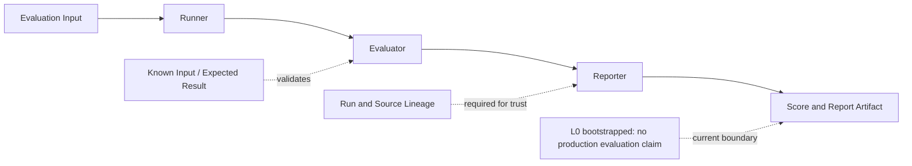

# x4-eval

X4 independent parent — **evaluation** (runner, evaluator, reporter). API/CLI. Fleet id **14**.

| Field | Value |
|-------|-------|
| Completion | **L0** — bootstrapped |
| Boundary | independent-parent |

No production evaluation is claimed until evidence states advance.

<!-- X4-APEX-DIAGRAM-START:x4-eval -->

<!-- X4-APEX-DIAGRAM-END:x4-eval -->

