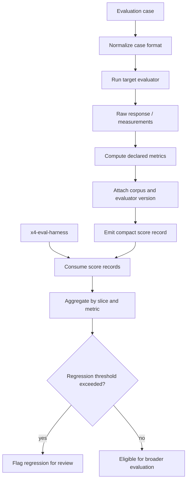

# x4-eval

X4 independent parent — **evaluation** (runner, evaluator, reporter). API/CLI. Fleet id **14**.

| Field | Value |
|-------|-------|
| Completion | **L0** — bootstrapped |
| Boundary | independent-parent |

No production evaluation is claimed until evidence states advance.

## APEX Architecture Map

> Status: architecture documentation; implementation and deployment claims require independent verification.

**Consolidation note:** This diagram treats x4-eval as a narrow scoring component and x4-eval-harness as the orchestrator. Verify the overlap before deciding whether to merge or retain both repositories.

